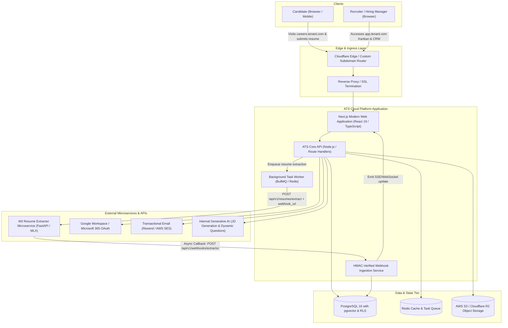
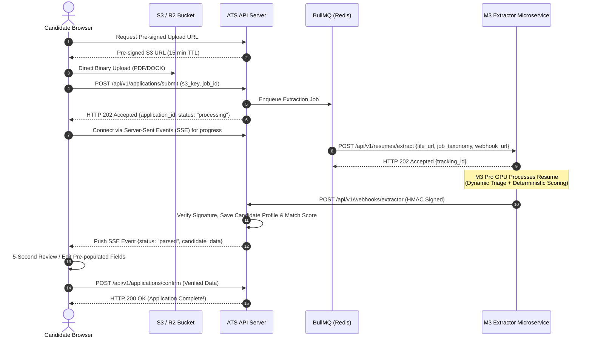

# Enterprise AI-Native Applicant Tracking System (ATS) SaaS
## Master Architectural Blueprint & System Design Specification

---

## 1. Executive Summary & Product Vision

### 1.1 The Product
We are designing and building an enterprise-grade, multi-tenant, AI-native **Applicant Tracking System (ATS) SaaS platform**. The platform acts as an autonomous **"Virtual Recruiter"** for modern hiring teams, eliminating top-of-funnel operational friction while keeping human decision-makers firmly in control.

### 1.2 Core Philosophy: *"Deterministic AI for Triage, Humans for Decisions"*
Traditional recruitment suffers from two extremes:
1. **Legacy ATS Black Holes (Workday, Greenhouse, Taleo):** Unintuitive Kanban boards where recruiters manually sift through hundreds of unstructured PDFs, leading to recruiter burnout and missed talent.
2. **Black-Box AI Recruiter Tools:** Non-transparent AI models making autonomous reject/pass decisions with unpredictable biases, legal liabilities, and zero explainability.

**Our Paradigm:**
* **Top-of-Funnel Automation:** Ingestion, document OCR, taxonomy extraction, technical skill cross-referencing, and initial gap pre-screening are automated.
* **Deterministic Explainability:** Candidate ranking is driven by a deterministic, mathematically verifiable match score generated against a normalized job taxonomy (provided by our dedicated extraction microservice).
* **Human-in-the-Loop Decision Authority:** Recruiters and hiring managers spend 100% of their bandwidth evaluating top mathematically matched candidates, conducting interviews, and building relationships.

---

## 2. System Boundaries & Service Separation

A fundamental architectural principle of this project is strict **separation of concerns** between the ATS SaaS Platform and the Resume Extraction Microservice:

```
┌────────────────────────────────────────────────────────────────────────────────────────┐
│                              SYSTEM BOUNDARY ARCHITECTURE                              │
└────────────────────────────────────────────────────────────────────────────────────────┘

    PUBLIC INTERNET / CLIENT BROWSERS
     │               │
     │ Candidates    │ Recruiters & Hiring Managers
     ▼               ▼
┌────────────────────────────────────────────────────────────────────────────────────────┐
│ [NEW PROJECT] ATS SAAS CLOUD PLATFORM                                                  │
│                                                                                        │
│  ┌───────────────────────┐  ┌────────────────────────┐  ┌───────────────────────────┐  │
│  │ Public Career Portal  │  │ Recruiter Workspace    │  │ Screening & Scheduling    │  │
│  │ (No-login dropzone)   │  │ (Kanban, Scorecards)   │  │ (Async AI interviews)     │  │
│  └───────────┬───────────┘  └───────────┬────────────┘  └─────────────┬─────────────┘  │
│              │                          │                             │                │
│  ┌───────────▼──────────────────────────▼─────────────────────────────▼─────────────┐  │
│  │ ATS Core Application Layer (Next.js / Node.js API / Background Workers)          │  │
│  └───────────┬──────────────────────────┬─────────────────────────────┬─────────────┘  │
│              │                          │                             │                │
│  ┌───────────▼───────────┐  ┌───────────▼────────────┐  ┌─────────────▼─────────────┐  │
│  │ PostgreSQL + pgvector │  │ Redis + BullMQ Queue   │  │ S3 / R2 Document Storage  │  │
│  │ (Multi-tenant RLS DB) │  │ (Async Jobs & Backoff) │  │ (Resumes, Media, Letters) │  │
│  └───────────────────────┘  └───────────┬────────────┘  └───────────────────────────┘  │
└─────────────────────────────────────────┼──────────────────────────────────────────────┘
                                          │
                               HTTPS REST │ (Ephemeral Payload / Webhook)
                                          ▼
┌────────────────────────────────────────────────────────────────────────────────────────┐
│ [EXISTING SERVICE] LOCAL RESUME EXTRACTION MICROSERVICE                                │
│ (Dedicated Apple Silicon M3 Pro Hardware • mlx-vlm • Qwen3-VL-8B-Instruct-4bit)        │
│                                                                                        │
│  • Concurrency Gate: asyncio.Semaphore(1) [Max 1 GPU job at a time]                    │
│  • Fast Dynamic Triage: pymupdf / python-docx (CPU) vs Vision OCR (GPU)                │
│  • Deterministic Scoring Engine (Pure Python rule-based match against JD)              │
│  • Zero Data Retention: Ephemeral file storage (immediate wipe post-extraction)        │
│  • Secure Webhook Callback: POST /api/v1/webhooks/extractor                            │
└────────────────────────────────────────────────────────────────────────────────────────┘
```

### Key Integration Contracts
1. **Loose Coupling:** The ATS communicates with the Extraction Microservice **exclusively over standard HTTP/HTTPS REST APIs**.
2. **Ephemeral Asset Sharing:** The ATS stores candidate documents securely in S3/R2 storage and provides a signed temporary URL or direct multipart stream to the extractor.
3. **Asynchronous Webhook Protocol:** Because visual vision-language processing on the M3 GPU takes 30–90 seconds per document and enforces an `asyncio.Semaphore(1)` hardware lock, the ATS **never holds long HTTP connections open** for scanned files. It issues a non-blocking `202 Accepted` request with a `webhook_url` and processes extraction results asynchronously.
4. **Resilience & Rate Limiting:** The ATS implements a durable background queue (BullMQ + Redis) to buffer spikes in candidate submissions, ensuring the local M3 Pro microservice is never swamped.

---

## 3. High-Level Architectural Blueprint (C4 Container Diagram)



---

## 4. Deep-Dive Specification by Module

### Module 1: Multi-Tenant Workspace & Enterprise Access Control (RBAC)

#### Architectural Requirements
* **Logical Database Isolation:** Single shared database using PostgreSQL **Row-Level Security (RLS)**. Every database table containing tenant data carries a `tenant_id UUID` column with a mandatory foreign key constraint to `tenants.id`.
* **Tenant Context Injection:** Every incoming HTTP request parses the active tenant from either:
  1. The authenticated user's session JWT (`tenant_id` claim), or
  2. The custom subdomain host header (e.g., `careers.acme.com` or `acme.hireflow.io`).
* **Zero Cross-Tenant Leakage:** The database connection pool automatically sets session context per transaction:
  ```sql
  SET LOCAL app.current_tenant_id = 'e7b1c402-8f92-411a-9825-f09c0d12e840';
  ```
  All RLS policies evaluate `tenant_id = NULLIF(current_setting('app.current_tenant_id', true), '')::uuid`.

#### Role-Based Access Control (RBAC) Matrix

| Permission / Capability | Admin / Founder | Recruiter | Hiring Manager | Blind Interviewer |
| :--- | :---: | :---: | :---: | :---: |
| **Workspace & Billing Management** | ✅ Full | ❌ No | ❌ No | ❌ No |
| **API Keys & Webhook Config** | ✅ Full | ❌ No | ❌ No | ❌ No |
| **Create & Publish Job Requisitions** | ✅ Full | ✅ Full | ⚠️ Draft Only | ❌ No |
| **Move Candidates Across Kanban** | ✅ Full | ✅ Full | ⚠️ Allowed Stages | ❌ No |
| **View Candidate PII & Unredacted Resumes** | ✅ Full | ✅ Full | ✅ Full | ❌ Redacted |
| **View Deterministic Match Score** | ✅ Full | ✅ Full | ✅ Full | ❌ Redacted |
| **Submit Interview Scorecard** | ✅ Full | ✅ Full | ✅ Full | ✅ Blind Scorecard |
| **View Other Interviewers' Feedback** | ✅ Full | ✅ Full | ✅ Post-submission | ❌ Hidden |
| **Trigger Automated Pre-Screens** | ✅ Full | ✅ Full | ❌ No | ❌ No |
| **Export Candidate Data / Compliance Reports**| ✅ Full | ⚠️ Restricted | ❌ No | ❌ No |

#### Subdomain & Custom Domain Routing
* **Wildcard DNS:** `*.ats-platform.com` routed to edge reverse proxy.
* **Custom Enterprise Domains:** CNAME validation (e.g. `careers.company.com` pointing to `domains.ats-platform.com`) with automated SSL certificate provisioning via Cloudflare for SaaS or Let's Encrypt / Caddy.

---

### Module 2: Generative Job Requisitions & Taxonomy Extraction

#### AI Job Description Generator
* **Input Interface:** Recruiter enters rough bullet points or conversational prompts (e.g., *"Staff Backend Engineer, 6+ years Go, Kubernetes, high-concurrency payment processing, remote US"*).
* **LLM Engine:** Internal structured LLM invocation (via Vercel AI SDK or Instructor) with an enforced Pydantic/Zod schema.
* **Output Structure:**
  * Job Title & Department
  * Seniority Level & Employment Type (Full-time, Contract)
  * Location & Remote Policy (Remote, Hybrid, On-site)
  * Compensation Range (Min, Max, Currency, Equity)
  * Company Mission / About Team
  * Role Responsibilities (bulleted)
  * Minimum Required Qualifications & Skills
  * Preferred / Nice-to-Have Skills
  * Inclusive EEO Statement & Reasonable Accommodation Notice

#### Automated Taxonomy Normalization for M3 Scoring
Before a job goes live, the platform extracts a clean, structured JSON taxonomy:
```json
{
  "job_id": "job_9481a8c0",
  "title": "Senior Backend Engineer",
  "taxonomy": {
    "required_skills": [
      {"name": "Go", "min_years": 4, "weight": 1.0},
      {"name": "Kubernetes", "min_years": 2, "weight": 1.0},
      {"name": "PostgreSQL", "min_years": 3, "weight": 0.9}
    ],
    "preferred_skills": [
      {"name": "Kafka", "weight": 0.5},
      {"name": "gRPC", "weight": 0.5},
      {"name": "AWS", "weight": 0.4}
    ],
    "min_total_experience_years": 5,
    "education_level": "Bachelors or Equivalent Practical Experience"
  }
}
```
*This taxonomy is saved in the database and directly supplied to the M3 Resume Extraction Microservice during candidate parsing to compute the deterministic match score.*

#### External Syndication & SEO Optimization
* **Google for Jobs Schema:** Automated injection of JSON-LD `JobPosting` schema markup on every public job posting page.
* **RSS / XML Feeds:** Standardized ATS feeds ready for syndication to LinkedIn, Indeed, and ZipRecruiter.

---

### Module 3: Zero-Friction Career Portal & Ingestion Gateway

#### The Candidate Experience: "Zero-Friction Dropzone"
* **No Account Creation Barrier:** Top engineers abandon lengthy ATS logins. Candidates apply in under 30 seconds.
* **Drag-and-Drop Uploader:** Supports PDF and DOCX formats up to 15MB.
* **Instant Client-Side Pre-validation:** Magic-number file header verification to reject corrupted files or disguised executables.

#### Ingestion Gateway Sequence Flow


#### Fallback & Resilience Strategy
If the local M3 Microservice is offline, under heavy load, or fails to respond within a timeout threshold:
* The candidate's application is saved safely in PostgreSQL with `status = "pending_extraction"`.
* The candidate is presented with standard manual input fields pre-filled from basic client-side PDF text extraction.
* A background retry worker attempts re-extraction when the M3 service reports healthy via its heartbeat endpoint.

---

### Module 4: Deterministic Triage & Interactive Kanban Pipeline

#### The Match-Scored Pipeline Dashboard
Recruiters spend 90% of their daily workflow inside this module.

```
┌────────────────────────────────────────────────────────────────────────────────────────┐
│  RECRUITER PIPELINE: Senior Backend Engineer (42 Applicants)                           │
├─────────────────┬──────────────────┬──────────────────┬─────────────────┬──────────────┤
│ APPLIED (28)    │ TECH SCREEN (6)  │ PRE-SCREEN (4)   │ INTERVIEW (3)   │ OFFER (1)    │
├─────────────────┼──────────────────┼──────────────────┼─────────────────┼──────────────┤
│ [Card 1]        │ [Card 4]         │ [Card 7]         │ [Card 9]        │ [Card 11]    │
│ Alex Mercer     │ Sarah Lin        │ David Chen       │ Elena Rostova   │ Marcus Vance │
│ Score: 94/100   │ Score: 91/100    │ Score: 89/100    │ Score: 95/100   │ Score: 98/100│
│ Match: Go, K8s  │ Async Audio Done │ Screen Complete  │ Onsite Passed   │ Pending Sign │
│ ────────────────│ ──────────────── │ ──────────────── │ ────────────────│ ─────────────│
│ [Card 2]        │ [Card 5]         │ [Card 8]         │ [Card 10]       │              │
│ Priya Sharma    │ James O'Connor   │ Maya Patel       │ Liam Smith      │              │
│ Score: 88/100   │ Score: 86/100    │ Score: 84/100    │ Score: 90/100   │              │
│ Match: Go, PG   │ Invite Sent      │ Review Scorecard │ Final Debrief   │              │
│ ────────────────│ ──────────────── │ ──────────────── │ ────────────────│              │
│ [Card 3]        │                  │                  │                 │              │
│ Jordan Miller   │                  │                  │                 │              │
│ Score: 62/100   │                  │                  │                 │              │
│ ❌ Missing: Go  │                  │                  │                 │              │
└─────────────────┴──────────────────┴──────────────────┴─────────────────┴──────────────┘
```

#### Key Dashboard Capabilities
1. **Deterministic Score Ordering:** Within the "Applied" column, candidates are auto-sorted by their deterministic match score rather than chronological arrival date.
2. **Match Breakdown Chip:** Every card displays instant visual badges:
   * 🟢 **Matched Core:** Go (5 yrs), Kubernetes (3 yrs), PostgreSQL
   * 🟡 **Preferred Match:** Kafka
   * 🔴 **Gaps:** gRPC missing
3. **Split-Screen Candidate Dossier Modal:**
   * **Left Pane (Structured Profile):** Extracted contact details, timeline work experience, education, verified skill tags, scorecard tabs, and team collaboration notes.
   * **Right Pane (High-Fidelity Document Viewer):** Embedded PDF.js viewer rendering the original candidate resume with in-document search, zoom, and highlight tools for rapid cross-referencing.
4. **Drag-and-Drop Stage Transitions:** Powered by `@dnd-kit/core` with optimistic UI updates and rollback on network failure.

---

### Module 5: Semantic Talent Pool (Vector RAG)

#### Eliminating the ATS "Black Hole"
In traditional systems, when a great candidate is rejected because only one hire was made, their resume sits dormant forever. Our semantic talent pool turns past candidates into an active, searchable sourcing database.

#### The Vector Ingestion Pipeline
1. When the M3 microservice returns candidate JSON, a background worker synthesizes a semantic representation of the candidate:
   ```
   Candidate Profile Synthesis:
   Title: Senior Distributed Systems Engineer
   Experience: 7 years
   Primary Skills: Go, Rust, Distributed Consensus, Raft, Kafka, Kubernetes
   Key Projects: Re-architected payment ledger handling 50k TPS; built multi-region Raft cluster.
   ```
2. ATS generates high-dimensional embeddings (e.g., OpenAI `text-embedding-3-small` or local HuggingFace embeddings via FastEmbed, 1536-dim).
3. The vector is saved in PostgreSQL using the `pgvector` extension: `candidates.embedding`.

#### Conversational Sourcing & Proactive Resurfacing
* **Natural Language Queries:** Recruiters can search:
  > *"Find me an engineer who has hands-on experience building low-latency payment processing pipelines or distributed ledgers."*
* **Hybrid Search (BM25 + Vector Cosine Similarity):** Combines exact keyword matching with deep semantic similarity for maximum precision.
* **Automated Resurfacing Engine:** Whenever a new Job Requisition is published:
  1. A background cron job embeds the job description.
  2. Executes a tenant-isolated vector similarity search against all previous applicants across all closed roles.
  3. Displays an actionable notification:
     > *"💡 We found 8 past applicants in your talent pool with an 88%+ match for this new Staff DevOps role. [Click to Review and 1-Click Invite]"*

---

### Module 6: Automated Pre-Screening & Auditing

#### Trigger-Based Asynchronous Screening Workflow
When a recruiter drags a candidate card into the **"Pre-Screen"** column:
1. The ATS generates a secure, signed, single-use URL with an expiration window (e.g., 72 hours).
2. The candidate receives an email invitation to complete a 5-minute asynchronous screening.

#### Dynamic AI Question Generation
Unlike generic questionnaires, questions are generated dynamically by analyzing the **candidate's specific skill gap breakdown** from Module 4 against the Job Description:
* *Identified Gap:* Candidate has 5 years React experience, but the JD requires Vue.js 3 with Pinia.
* *Dynamically Generated Question:*
  > *"Your background demonstrates strong expertise in React component architecture. How would you approach transitioning state management patterns from Redux/Zustand to Vue 3's Composition API and Pinia on a production project?"*

#### The Screening Experience & Scorecard Generation
* **Candidate Interface:** Clean, time-boxed web interface. Supports text answers or 60-second webcam/microphone responses via the HTML5 `MediaRecorder` API.
* **Automated Evaluation Pipeline:**
  1. Audio responses are transcribed via Whisper.
  2. ATS runs an evaluation against a strict rubric (Clarity, Technical Depth, Relevant Experience).
  3. Generates a structured **Screening Scorecard**:
     * Score summary (e.g., 4.2 / 5.0)
     * Key strengths demonstrated
     * Potential areas for deeper live interview probing
     * Full verbatim transcript with audio playback
* **Strict Anti-Bias Rule:** The AI screening scorecard is strictly **advisory**. The system never automatically rejects candidates based on AI evaluation; it highlights candidate responses for human recruiter review.

---

### Module 7: Interview Coordination & Communication

#### Two-Way Calendar Integration
* **OAuth 2.0 Integration:** Google Workspace (Google Calendar API) and Microsoft 365 (Microsoft Graph API).
* **Smart Availability Detection:**
  * Checks hiring manager and interview panel calendars in real-time.
  * Respects configurable buffers (e.g., minimum 15-minute gap between interviews, max 3 interviews per day).
* **Self-Scheduling Links:** Candidates receive a unique link showing only valid interview slots, automatically generating Google Meet / Microsoft Teams / Zoom links upon selection.

#### Automated Communication & The "Polite Delay" Queue
* **Delayed Rejection Engine:** Moving a candidate to "Rejected" does not send an instantaneous email. Instant rejections damage employer brand by signaling automated dismissal. The email is scheduled into a delayed queue (e.g., dispatched after 36 to 48 hours during business hours).
* **Dynamic Template Tokens:** Complete template editor supporting variables (`{{candidate_name}}`, `{{job_title}}`, `{{company_name}}`, `{{feedback_summary}}`).
* **Offer Stage Automation:** Automatically generates an offer letter PDF populated with candidate details, compensation, and start date, with integration hooks for DocuSign / HelloSign.

#### Team Collaboration & Blind Scorecards
* **Candidate Discussion Feed:** Internal timeline on each candidate card supporting `@mentions` and real-time notifications.
* **Blind Interview Enforcement:** To eliminate interviewer bias (e.g., interviewer B being influenced by interviewer A's comments), an interviewer cannot see colleagues' scorecards until their own scorecard has been submitted and locked.

---

## 5. Complete Database Schema Architecture (PostgreSQL + pgvector)

Below is the production DDL schema designed for high-throughput multi-tenancy, strict referential integrity, and Row-Level Security.

```sql
-- ============================================================================
-- 1. EXTENSIONS & ENUMS
-- ============================================================================
CREATE EXTENSION IF NOT EXISTS "uuid-ossp";
CREATE EXTENSION IF NOT EXISTS "vector";
CREATE EXTENSION IF NOT EXISTS "pgcrypto";

CREATE TYPE user_role AS ENUM (
    'admin', 
    'recruiter', 
    'hiring_manager', 
    'interviewer'
);

CREATE TYPE job_status AS ENUM (
    'draft', 
    'published', 
    'paused', 
    'closed', 
    'archived'
);

CREATE TYPE application_status AS ENUM (
    'pending_extraction',
    'applied',
    'screening_invited',
    'screening_completed',
    'interview_scheduled',
    'interview_completed',
    'offered',
    'hired',
    'rejected',
    'withdrawn'
);

CREATE TYPE screening_status AS ENUM (
    'pending', 
    'opened', 
    'completed', 
    'expired'
);

-- ============================================================================
-- 2. TENANTS & USERS
-- ============================================================================
CREATE TABLE tenants (
    id UUID PRIMARY KEY DEFAULT gen_random_uuid(),
    name VARCHAR(255) NOT NULL,
    subdomain VARCHAR(63) NOT NULL UNIQUE,
    custom_domain VARCHAR(255) UNIQUE,
    logo_url TEXT,
    primary_color VARCHAR(7) DEFAULT '#2563EB',
    settings_json JSONB DEFAULT '{}'::jsonb,
    created_at TIMESTAMPTZ NOT NULL DEFAULT NOW(),
    updated_at TIMESTAMPTZ NOT NULL DEFAULT NOW()
);

CREATE INDEX idx_tenants_subdomain ON tenants(subdomain);

CREATE TABLE users (
    id UUID PRIMARY KEY DEFAULT gen_random_uuid(),
    tenant_id UUID NOT NULL REFERENCES tenants(id) ON DELETE CASCADE,
    email VARCHAR(255) NOT NULL,
    full_name VARCHAR(255) NOT NULL,
    role user_role NOT NULL DEFAULT 'recruiter',
    department VARCHAR(100),
    avatar_url TEXT,
    is_active BOOLEAN NOT NULL DEFAULT TRUE,
    created_at TIMESTAMPTZ NOT NULL DEFAULT NOW(),
    updated_at TIMESTAMPTZ NOT NULL DEFAULT NOW(),
    CONSTRAINT uq_tenant_user_email UNIQUE (tenant_id, email)
);

CREATE INDEX idx_users_tenant_role ON users(tenant_id, role);

-- ============================================================================
-- 3. JOBS & TAXONOMIES
-- ============================================================================
CREATE TABLE jobs (
    id UUID PRIMARY KEY DEFAULT gen_random_uuid(),
    tenant_id UUID NOT NULL REFERENCES tenants(id) ON DELETE CASCADE,
    title VARCHAR(255) NOT NULL,
    slug VARCHAR(255) NOT NULL,
    department VARCHAR(100) NOT NULL,
    location VARCHAR(100) NOT NULL,
    remote_policy VARCHAR(50) NOT NULL DEFAULT 'remote',
    salary_min NUMERIC(12, 2),
    salary_max NUMERIC(12, 2),
    currency VARCHAR(3) DEFAULT 'USD',
    description_markdown TEXT NOT NULL,
    description_html TEXT NOT NULL,
    taxonomy_json JSONB NOT NULL DEFAULT '{}'::jsonb, -- Required/preferred skills for M3 scoring
    status job_status NOT NULL DEFAULT 'draft',
    creator_id UUID REFERENCES users(id) ON DELETE SET NULL,
    created_at TIMESTAMPTZ NOT NULL DEFAULT NOW(),
    updated_at TIMESTAMPTZ NOT NULL DEFAULT NOW(),
    CONSTRAINT uq_tenant_job_slug UNIQUE (tenant_id, slug)
);

CREATE INDEX idx_jobs_tenant_status ON jobs(tenant_id, status);

CREATE TABLE pipeline_stages (
    id UUID PRIMARY KEY DEFAULT gen_random_uuid(),
    tenant_id UUID NOT NULL REFERENCES tenants(id) ON DELETE CASCADE,
    job_id UUID REFERENCES jobs(id) ON DELETE CASCADE, -- NULL means tenant default stage
    name VARCHAR(100) NOT NULL,
    position_index INT NOT NULL,
    stage_type VARCHAR(50) NOT NULL, -- 'applied', 'screen', 'interview', 'offer', 'hired', 'rejected'
    automated_actions_json JSONB DEFAULT '{}'::jsonb,
    created_at TIMESTAMPTZ NOT NULL DEFAULT NOW()
);

CREATE INDEX idx_pipeline_stages_job_pos ON pipeline_stages(job_id, position_index);

-- ============================================================================
-- 4. CANDIDATES & APPLICATIONS
-- ============================================================================
CREATE TABLE candidates (
    id UUID PRIMARY KEY DEFAULT gen_random_uuid(),
    tenant_id UUID NOT NULL REFERENCES tenants(id) ON DELETE CASCADE,
    first_name VARCHAR(100),
    last_name VARCHAR(100),
    email VARCHAR(255) NOT NULL,
    phone VARCHAR(50),
    linkedin_url TEXT,
    github_url TEXT,
    portfolio_url TEXT,
    location VARCHAR(150),
    parsed_profile_json JSONB NOT NULL DEFAULT '{}'::jsonb, -- Raw extraction envelope
    original_resume_s3_key TEXT NOT NULL,
    resume_file_name VARCHAR(255) NOT NULL,
    resume_mime_type VARCHAR(100) NOT NULL,
    resume_file_size_bytes INT NOT NULL,
    created_at TIMESTAMPTZ NOT NULL DEFAULT NOW(),
    updated_at TIMESTAMPTZ NOT NULL DEFAULT NOW(),
    CONSTRAINT uq_tenant_candidate_email UNIQUE (tenant_id, email)
);

CREATE INDEX idx_candidates_tenant_email ON candidates(tenant_id, email);

-- Semantic Embeddings for Module 5 Vector RAG (FastEmbed: BAAI/bge-small-en-v1.5)
CREATE TABLE candidate_embeddings (
    id UUID PRIMARY KEY DEFAULT gen_random_uuid(),
    tenant_id UUID NOT NULL REFERENCES tenants(id) ON DELETE CASCADE,
    candidate_id UUID NOT NULL REFERENCES candidates(id) ON DELETE CASCADE,
    content_chunk TEXT NOT NULL,
    embedding vector(384) NOT NULL,
    created_at TIMESTAMPTZ NOT NULL DEFAULT NOW(),
    CONSTRAINT uq_candidate_embedding UNIQUE (candidate_id)
);

CREATE INDEX idx_candidate_embeddings_vector ON candidate_embeddings 
USING ivfflat (embedding vector_cosine_ops) WITH (lists = 100);

CREATE TABLE job_applications (
    id UUID PRIMARY KEY DEFAULT gen_random_uuid(),
    tenant_id UUID NOT NULL REFERENCES tenants(id) ON DELETE CASCADE,
    job_id UUID NOT NULL REFERENCES jobs(id) ON DELETE CASCADE,
    candidate_id UUID NOT NULL REFERENCES candidates(id) ON DELETE CASCADE,
    current_stage_id UUID REFERENCES pipeline_stages(id) ON DELETE SET NULL,
    status application_status NOT NULL DEFAULT 'pending_extraction',
    deterministic_match_score NUMERIC(5, 2), -- Output from M3 microservice (0.00 - 100.00)
    match_breakdown_json JSONB DEFAULT '{}'::jsonb, -- Matched, missing, delta skills
    extractor_tracking_id VARCHAR(100),
    applied_at TIMESTAMPTZ NOT NULL DEFAULT NOW(),
    updated_at TIMESTAMPTZ NOT NULL DEFAULT NOW(),
    CONSTRAINT uq_job_candidate_app UNIQUE (job_id, candidate_id)
);

CREATE INDEX idx_applications_job_stage ON job_applications(job_id, current_stage_id);
CREATE INDEX idx_applications_job_score ON job_applications(job_id, deterministic_match_score DESC NULLS LAST);

-- ============================================================================
-- 5. ASYNC SCREENING & ASSESSMENTS (Module 6)
-- ============================================================================
CREATE TABLE screenings (
    id UUID PRIMARY KEY DEFAULT gen_random_uuid(),
    tenant_id UUID NOT NULL REFERENCES tenants(id) ON DELETE CASCADE,
    application_id UUID NOT NULL REFERENCES job_applications(id) ON DELETE CASCADE,
    access_token VARCHAR(128) NOT NULL UNIQUE,
    status screening_status NOT NULL DEFAULT 'pending',
    expires_at TIMESTAMPTZ NOT NULL,
    questions_json JSONB NOT NULL DEFAULT '[]'::jsonb,
    responses_json JSONB NOT NULL DEFAULT '[]'::jsonb,
    ai_evaluation_json JSONB DEFAULT '{}'::jsonb,
    submitted_at TIMESTAMPTZ,
    created_at TIMESTAMPTZ NOT NULL DEFAULT NOW()
);

CREATE INDEX idx_screenings_token ON screenings(access_token);
CREATE INDEX idx_screenings_app ON screenings(application_id);

-- ============================================================================
-- 6. INTERVIEWS, SCORECARDS & COLLABORATION (Module 7)
-- ============================================================================
CREATE TABLE interviews (
    id UUID PRIMARY KEY DEFAULT gen_random_uuid(),
    tenant_id UUID NOT NULL REFERENCES tenants(id) ON DELETE CASCADE,
    application_id UUID NOT NULL REFERENCES job_applications(id) ON DELETE CASCADE,
    interviewer_id UUID NOT NULL REFERENCES users(id) ON DELETE RESTRICT,
    title VARCHAR(200) NOT NULL,
    scheduled_start TIMESTAMPTZ NOT NULL,
    scheduled_end TIMESTAMPTZ NOT NULL,
    meeting_url TEXT,
    calendar_event_id VARCHAR(255),
    created_at TIMESTAMPTZ NOT NULL DEFAULT NOW()
);

CREATE TABLE scorecards (
    id UUID PRIMARY KEY DEFAULT gen_random_uuid(),
    tenant_id UUID NOT NULL REFERENCES tenants(id) ON DELETE CASCADE,
    interview_id UUID REFERENCES interviews(id) ON DELETE CASCADE,
    application_id UUID NOT NULL REFERENCES job_applications(id) ON DELETE CASCADE,
    evaluator_id UUID NOT NULL REFERENCES users(id) ON DELETE RESTRICT,
    overall_recommendation VARCHAR(50) NOT NULL, -- 'strong_yes', 'yes', 'no', 'strong_no'
    scores_json JSONB NOT NULL DEFAULT '{}'::jsonb, -- Category ratings (1-5)
    notes_markdown TEXT,
    is_submitted BOOLEAN NOT NULL DEFAULT FALSE,
    submitted_at TIMESTAMPTZ,
    created_at TIMESTAMPTZ NOT NULL DEFAULT NOW(),
    CONSTRAINT uq_interview_evaluator UNIQUE (interview_id, evaluator_id)
);

CREATE TABLE candidate_notes (
    id UUID PRIMARY KEY DEFAULT gen_random_uuid(),
    tenant_id UUID NOT NULL REFERENCES tenants(id) ON DELETE CASCADE,
    application_id UUID NOT NULL REFERENCES job_applications(id) ON DELETE CASCADE,
    author_id UUID NOT NULL REFERENCES users(id) ON DELETE RESTRICT,
    content_markdown TEXT NOT NULL,
    mentions_json JSONB DEFAULT '[]'::jsonb,
    created_at TIMESTAMPTZ NOT NULL DEFAULT NOW()
);

-- ============================================================================
-- 7. AUDIT TRAIL & COMPLIANCE LOGS
-- ============================================================================
CREATE TABLE audit_logs (
    id UUID PRIMARY KEY DEFAULT gen_random_uuid(),
    tenant_id UUID NOT NULL REFERENCES tenants(id) ON DELETE CASCADE,
    actor_id UUID REFERENCES users(id) ON DELETE SET NULL,
    action VARCHAR(100) NOT NULL, -- e.g., 'stage_changed', 'scorecard_submitted', 'resume_downloaded'
    entity_type VARCHAR(50) NOT NULL,
    entity_id UUID NOT NULL,
    metadata_json JSONB DEFAULT '{}'::jsonb,
    ip_address INET,
    user_agent TEXT,
    created_at TIMESTAMPTZ NOT NULL DEFAULT NOW()
);

CREATE INDEX idx_audit_logs_tenant_entity ON audit_logs(tenant_id, entity_type, entity_id);

-- ============================================================================
-- 8. ROW LEVEL SECURITY (RLS) POLICIES
-- ============================================================================
ALTER TABLE tenants ENABLE ROW LEVEL SECURITY;
ALTER TABLE users ENABLE ROW LEVEL SECURITY;
ALTER TABLE jobs ENABLE ROW LEVEL SECURITY;
ALTER TABLE pipeline_stages ENABLE ROW LEVEL SECURITY;
ALTER TABLE candidates ENABLE ROW LEVEL SECURITY;
ALTER TABLE candidate_embeddings ENABLE ROW LEVEL SECURITY;
ALTER TABLE job_applications ENABLE ROW LEVEL SECURITY;
ALTER TABLE screenings ENABLE ROW LEVEL SECURITY;
ALTER TABLE interviews ENABLE ROW LEVEL SECURITY;
ALTER TABLE scorecards ENABLE ROW LEVEL SECURITY;
ALTER TABLE candidate_notes ENABLE ROW LEVEL SECURITY;
ALTER TABLE audit_logs ENABLE ROW LEVEL SECURITY;

-- Generic RLS Policy Pattern (Applied to all tenant-scoped tables)
CREATE POLICY tenant_isolation_jobs ON jobs
    USING (tenant_id = NULLIF(current_setting('app.current_tenant_id', true), '')::uuid);

CREATE POLICY tenant_isolation_candidates ON candidates
    USING (tenant_id = NULLIF(current_setting('app.current_tenant_id', true), '')::uuid);

CREATE POLICY tenant_isolation_applications ON job_applications
    USING (tenant_id = NULLIF(current_setting('app.current_tenant_id', true), '')::uuid);
```

---

## 6. Detailed Integration Specification: ATS <-> M3 Resume Extractor Microservice

### 6.1 M3 Microservice Capabilities & Constraints
From `resumeExtractor.md`, the extraction microservice features:
* **Hardware:** Native Apple Silicon M3 Pro with `mlx-vlm` and `Qwen3-VL-8B-Instruct-4bit`.
* **Hardware Lock:** `asyncio.Semaphore(1)` enforces strictly **one concurrent GPU job**.
* **Memory Ceiling:** 13.3 GiB Metal working limit.
* **Extraction Timing:** 
  * CPU digital path (PyMuPDF / python-docx): 1–3 seconds.
  * GPU vision OCR path (rasterized PDFs / scanned images): 30–90 seconds.
* **Authentication:** `X-API-Key` required in request header.
* **Security:** Ephemeral file storage (local copies permanently deleted upon extraction).

### 6.2 ATS Outbound Request Protocol
When a candidate applies or a recruiter batch-uploads resumes:

```http
POST /api/v1/resumes/extract HTTP/1.1
Host: extractor-m3.internal.lan:8000
X-API-Key: sec_live_98ab47c102df01
Content-Type: multipart/form-data; boundary=----BoundaryX7A9

------BoundaryX7A9
Content-Disposition: form-data; name="file"; filename="alex_mercer_resume.pdf"
Content-Type: application/pdf

<Binary PDF Data>
------BoundaryX7A9
Content-Disposition: form-data; name="job_description"
Content-Type: application/json

{
  "job_id": "job_9481a8c0",
  "title": "Senior Backend Engineer",
  "required_skills": ["Go", "Kubernetes", "PostgreSQL"],
  "preferred_skills": ["Kafka", "gRPC"],
  "min_years_experience": 5
}
------BoundaryX7A9
Content-Disposition: form-data; name="webhook_url"

https://api.hireflow-ats.com/api/v1/webhooks/extractor
------BoundaryX7A9
Content-Disposition: form-data; name="callback_context"
Content-Type: application/json

{
  "tenant_id": "e7b1c402-8f92-411a-9825-f09c0d12e840",
  "application_id": "app_281f9a0c",
  "candidate_id": "cand_710bc4a9"
}
------BoundaryX7A9--
```

#### Synchronous Response from M3 Extractor:
```json
{
  "status": "queued",
  "tracking_id": "trk_m3_88301fa0",
  "message": "Resume accepted for asynchronous processing. Results will be delivered to webhook."
}
```
*HTTP Status: `202 Accepted`*

### 6.3 Asynchronous Webhook Delivery Contract (M3 -> ATS)
Once visual extraction and deterministic scoring complete on the M3 device, the microservice invokes the ATS webhook endpoint:

```http
POST /api/v1/webhooks/extractor HTTP/1.1
Host: api.hireflow-ats.com
X-Webhook-Signature: sha256=4f2a89c93847e1920bd8... (HMAC-SHA256 of payload)
Content-Type: application/json

{
  "tracking_id": "trk_m3_88301fa0",
  "callback_context": {
    "tenant_id": "e7b1c402-8f92-411a-9825-f09c0d12e840",
    "application_id": "app_281f9a0c",
    "candidate_id": "cand_710bc4a9"
  },
  "status": "success",
  "execution_metrics": {
    "triage_route": "gpu_vlm_vision",
    "processing_time_seconds": 42.8,
    "auto_repair_triggered": false
  },
  "candidate_profile": {
    "contact": {
      "full_name": "Alex Mercer",
      "email": "alex.mercer@example.com",
      "phone": "+1-555-019-2834",
      "linkedin": "https://linkedin.com/in/alexmercer",
      "github": "https://github.com/alexmercer-dev",
      "location": "San Francisco, CA"
    },
    "work_experience": [
      {
        "company": "Stripe",
        "title": "Senior Software Engineer",
        "start_date": "2021-03",
        "end_date": "Present",
        "highlights": [
          "Led development of high-throughput Go payments gateway processing 30k TPS",
          "Managed Kubernetes cluster deployments with Helm and ArgoCD"
        ],
        "technologies": ["Go", "Kubernetes", "PostgreSQL", "Kafka"]
      }
    ],
    "education": [
      {
        "institution": "University of California, Berkeley",
        "degree": "B.S. in Computer Science",
        "graduation_year": 2018
      }
    ],
    "skills": ["Go", "Kubernetes", "PostgreSQL", "Kafka", "Docker", "AWS", "gRPC", "Redis"]
  },
  "deterministic_match": {
    "overall_score": 94.0,
    "breakdown": {
      "matched_required": [
        {"skill": "Go", "evidence": "Used at Stripe (3+ years)"},
        {"skill": "Kubernetes", "evidence": "Production deployments at Stripe"},
        {"skill": "PostgreSQL", "evidence": "Primary datastore experience"}
      ],
      "missing_required": [],
      "matched_preferred": [
        {"skill": "Kafka", "evidence": "Listed in Stripe tech stack"},
        {"skill": "gRPC", "evidence": "Listed in skills inventory"}
      ],
      "missing_preferred": []
    },
    "experience_match": {
      "candidate_years": 6.0,
      "required_years": 5.0,
      "meets_criteria": true
    }
  }
}
```

### 6.4 Rate Limiting & Queue Orchestration
Since the M3 hardware is constrained to a single concurrent GPU task:
* The ATS uses **ARQ with Redis** (or Celery) to govern outbound calls to the M3 service.
* Concurrency on the ATS outbound worker is set to match the microservice capacity (e.g., concurrency = 1 for single M3 node, or scaled if multiple M3 nodes exist in a cluster).
* Exponential backoff and retry: 3 retries with 5s, 15s, 45s intervals on 503/timeout responses.

---

## 7. Technology Stack Selection Matrix & Agent Directives

> [!IMPORTANT]
> **Strict Agent Directives & Technology Constraints (See [antigravity.md](antigravity.md))**
> * **Backend Framework Mandate:** **FastAPI ONLY** (Python 3.11+, Pydantic v2, async endpoints). Strictly **NO Django**, **NO Flask**, and **NO Express/Node backends**.
> * **Testing Mandate:** **NO WEB TESTING** (no browser automation/subagents). All verification must be performed using **Python test scripts (`py script test`)** via `pytest` and `httpx`.
> * **Agent Role Protocol:** Operational hierarchy enforced across **L1 (Architect)**, **L2 (Project Manager)**, **L3 (Senior Backend Engineer)**, **L4 (Frontend Engineer)**, and **L5 (HR Tester)**.

| Tier / Function | Mandated Technology | Architectural Justification |
| :--- | :--- | :--- |
| **Backend API Framework** | **FastAPI (Python 3.11+, Pydantic v2, Async)** | High-performance asynchronous REST endpoints on port 8001, native OpenAPI generation, strict Pydantic v2 validation, seamless integration with asyncpg and AI workflows. Strictly NO Django or Flask. |
| **Frontend Framework** | **Next.js 15 (React 19, TypeScript)** | High-performance SSR public career portal on port 3000 (SEO for Google for Jobs), responsive recruiter dashboard, smooth client components. |
| **Authentication & RBAC**| **Clerk (Organizations & Next.js Components)** | Multi-tenant organization support, `<OrganizationSwitcher />`, `<SignIn />`, session JWT validated in FastAPI via Clerk JWKS public keys. Mock token fixtures for headless Python test scripts. |
| **Styling & Design System**| **TailwindCSS v4 / Modern CSS Tokens + Radix UI** | Modern accessible primitives, curated dark/light color palettes, smooth micro-interactions. |
| **Interactive Pipeline** | **@dnd-kit/core + @dnd-kit/sortable** | Accessible, 60fps drag-and-drop Kanban board with deterministic score ordering. |
| **Document Viewer** | **PDF.js (Mozilla) / React-PDF** | Client-side split-screen PDF rendering with zoom, search, and text layer selection. |
| **Database & Search** | **PostgreSQL 16 + pgvector (via Docker Compose)** | Enterprise ACID reliability, Row-Level Security (RLS) for multi-tenancy, and native vector embeddings. Provisioned via `docker-compose.yml` (`pgvector/pgvector:pg16`). |
| **ORM / Data Layer** | **SQLAlchemy 2.0 (Async) / asyncpg** | High-performance asynchronous PostgreSQL driver with explicit transaction management and RLS session injection. |
| **Task Queue & Cache** | **Redis 7 + ARQ (via Docker Compose)** | Python-native async task queue to rate-limit outbound requests to the M3 Resume Extractor (`Semaphore(1)`), handle retries, and process delayed rejections. |
| **Object Storage** | **Local Driver (Dev/Test) / Cloudflare R2 / AWS S3 (Prod)** | Local uploads folder with simulated pre-signed URLs for dev & test scripts; pluggable S3/R2 client (`aioboto3`) via `.env` for production. |
| **Vector Embeddings** | **FastEmbed (BAAI/bge-small-en-v1.5, vector(384))** | Ultra-fast local on-device embeddings, zero cloud API cost, compact 384-dimensional representation in `pgvector`. |
| **Internal LLM Engine** | **Local Ollama (llama3.2:3b default)** | On-device structured generation for Job Requisitions (Module 2) and dynamic pre-screen questions (Module 6). Configurable via `OLLAMA_MODEL` in `.env`. |
| **Audio Transcription** | **faster-whisper (base.en, on-device)** | Local on-device transcription for Module 6 candidate audio responses. Zero external API fees. |
| **External M3 Extractor**| **Local M3 Pro Microservice (Port 8000)** | Dedicated hardware microservice running on `http://localhost:8000`, accessed strictly via asynchronous REST and HMAC-signed webhook. |
| **Testing Engine** | **Python Test Scripts (`pytest`, `httpx.AsyncClient`)** | Headless automated verification for all API routes, webhook ingestion, and HR user journey simulations. Strictly zero web/browser automation. |


---

## 8. Security, Compliance & Ethical Governance

### 8.1 SOC2 & GDPR Compliance Architecture
1. **Right to Be Forgotten (GDPR Article 17):**
   * Single-command tenant/candidate erasure.
   * Cascade deletes remove candidate record, embeddings, applications, scorecards, and issues an asynchronous S3 object deletion command.
2. **Ephemeral Upload Retention Options:**
   * Configurable per-tenant data retention policy (e.g., auto-purge original PDF files after 90 days while retaining structured anonymized metrics).
3. **Data Encryption:**
   * In transit: Mandatory TLS 1.3 across all public and internal service calls.
   * At rest: AES-256 encryption on PostgreSQL volumes and S3 storage buckets.

### 8.2 Blind Hiring & Bias Mitigation (Module 1 & 4)
* **Blind Interview Mode:** When activated for a stage, the system redacts candidate names, photos, gender markers, graduation years, and addresses for interviewers. Interviewers evaluate candidates purely on structured skills, project highlights, and objective code/task scorecards.
* **Deterministic Scoring Auditability:** AI is never permitted to produce an opaque "hire / no hire" verdict. The deterministic match score is an open mathematical function based on validated required skills.

---

## 9. Phase-by-Phase Engineering Roadmap

```
┌────────────────────────────────────────────────────────────────────────────────────────┐
│                        ENGINEERING ROADMAP & PHASE PROGRESSION                         │
└────────────────────────────────────────────────────────────────────────────────────────┘

 [PHASE 1] Core Foundation & Multi-Tenant RBAC
   ├── PostgreSQL Schema + pgvector setup + SQLAlchemy 2.0 (Async)
   ├── Row-Level Security (RLS) enforcement & tenant context injection
   └── Authentication, User Roles, and Custom Subdomain routing

 [PHASE 2] Generative Job Requisitions & Career Portal
   ├── AI Job Description generator with structured JSON taxonomy extraction
   ├── SEO-optimized public career portal (careers.tenant.com)
   └── Zero-friction drag-and-drop resume dropzone with direct S3 pre-signed upload

 [PHASE 3] Webhook Integration & Deterministic Kanban Pipeline
   ├── ARQ / Redis queue integration with M3 Extraction Microservice
   ├── Secure HMAC-verified webhook endpoint (/api/v1/webhooks/extractor)
   ├── Interactive Kanban board with deterministic score ordering
   └── SSE / WebSocket real-time card progression updates

 [PHASE 4] Candidate Dossier & Collaborative Review
   ├── Split-screen Candidate Modal (Left: Profile Data, Right: PDF.js Viewer)
   ├── Match breakdown chip visualization (✅ Matched, ⚠️ Partial, ❌ Missing)
   └── Internal team discussion feed with @mentions and activity audit log

 [PHASE 5] Semantic Talent Pool (Vector RAG)
   ├── Automated profile synthesis & pgvector embedding pipeline
   ├── Natural language conversational sourcing search engine
   └── Proactive talent resurfacing alerts for newly opened job requisitions

 [PHASE 6] Automated Pre-Screening & Auditing Engine
   ├── Dynamic gap-question generator based on missing candidate skills
   ├── Candidate screening web portal with text & MediaRecorder audio support
   └── Whisper transcription & structured advisory rubric scorecard

 [PHASE 7] Interview Coordination & Enterprise Polish
   ├── Google Workspace & Microsoft 365 two-way calendar sync
   ├── Self-scheduling link generator for candidates
   ├── Smart delayed polite rejection queue & offer letter generation
   └── Blind interview scorecards & final SOC2/GDPR compliance auditing
```

---

## 10. Risk Analysis & Architectural Mitigations

| Risk / Failure Mode | Likelihood | Impact | Architectural Mitigation Strategy |
| :--- | :---: | :---: | :--- |
| **M3 GPU Bottleneck (High Volume Spike)** | High | Medium | BullMQ durable queue with rate-limited dispatch. Webhook ingestion ensures the cloud ATS never blocks. Candidate UI shows graceful "Processing" status with SSE progress indicator. |
| **M3 Microservice Network Outage** | Medium | High | Dead-Letter Queue (DLQ) with exponential backoff (up to 5 retries). Fallback client-side text extractor allows candidates to submit applications without blocking. |
| **Cross-Tenant Data Leakage** | Low | Critical | PostgreSQL Row-Level Security (RLS) enforced at the database kernel level; automated tenant context injection via Drizzle middleware; integration test suite validating tenant isolation on every API route. |
| **LLM Output Hallucination in JDs / Questions** | Medium | Low | Enforced structured outputs using Pydantic / Zod schemas; deterministic validation against known taxonomy tables before saving to database. |
| **Email Deliverability & Spam Flagging** | Medium | Medium | Integration with verified transactional providers (Resend / AWS SES) with automated DKIM, SPF, and DMARC configuration guidance per custom tenant domain. |

---

## 11. Architectural Sign-Off & Next Steps

This document serves as the **Master System Architecture Specification** for the AI-Native Applicant Tracking System SaaS platform.

* **Status:** ARCHITECTURAL DESIGN COMPLETE (Ready for Implementation Planning)
* **Next Action:** Upon user review and approval, proceed to Phase 1 implementation (Project Scaffolding, Multi-tenant Database Schema, Drizzle ORM, and RBAC Authentication).
